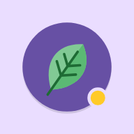

<p align="center">
  
  
  
  
</p>

<h1 align="center">Små appar, hög nivå</h1>

<p align="center">
  <b>En fråga. Din data. Inget mer.</b><br>
  Fyra mobilappar byggda från samma mall – ingen inloggning, ingen server, din data stannar i telefonen.
</p>

<p align="center">
  <a href="https://flyinggooner.github.io/"><b>Startsidan</b></a> ·
  <a href="https://flyinggooner.github.io/presentation.html"><b>Presentationen som bildspel</b></a>
</p>

---

## 📱 Apparna

| | App | Frågan den svarar på |
|:-:|---|---|
|  | **[Simple nutrition](https://flyinggooner.github.io/simple-nutrition/)** | Vad har jag ätit i dag – och hur går vikten över tid? |
|  | **[Budget buddy](https://flyinggooner.github.io/budget-buddy/)** | Går månaden ihop – och var blir det tight framåt? |
|  | **[Football, not soccer](https://flyinggooner.github.io/Football-not-soccer/)** | Hur ser tabellen ut, vad spelas härnäst, hur gick det för mitt lag? |
|  | **[Stress kontroll](https://flyinggooner.github.io/Stress-control/)** | Vad snurrar i huvudet – och vad är nästa steg, så att jag kan släppa det? |

> **Installera:** öppna appen i Chrome (Android) eller Safari (iPhone) och välj *Installera app* / *Lägg till på hemskärmen*. Den fungerar sedan utan nät.

---

## 💡 Utgångspunkten: de flesta appar vill för mycket

Konto först. Notiser, reklam, nyheter, uppsälj. Din data på någon annans server. Funktioner du aldrig bad om.

- 🍽️ **Kaloriappen** har tusentals märkesdubbletter och en premiumvägg – när du bara ville lära dig vad maten innehåller.
- 💸 **Budgetappen** vill koppla till banken och sortera varje kaffe – när du bara ville veta om månaden går ihop.
- ⚽ **Fotbollsappen** är full av nyheter, spel och notiser – när du bara ville se tabellen.

**De här apparna är motpolen: en fråga, ett bra svar, inget mer.**

---

## 🧭 Fem principer

| | Princip | Vad det betyder |
|:-:|---|---|
| 🎯 | **En fråga per app** | Allt som inte hjälper till att svara på den väljs bort. |
| 🔒 | **Din data är din** | Den stannar i telefonen. Inget konto, ingen server, ingen spårning. |
| ⚡ | **Snabbt i vardagen** | Det vanligaste tar några sekunder – resten kan fyllas i senare. |
| 🔍 | **Enkelt att lita på** | Liten kod utan beroenden, som går att läsa och testa. |
| 🔁 | **Bättre tillsammans** | Det som blir bättre i en app förs in i alla. |

### 🎯 Det som väljs bort är lika viktigt

Varje app har en lista över *icke-mål* – saker som medvetet inte byggs, hur lockande de än är.

| App | Medvetet bortvalt |
|---|---|
| Simple nutrition | Varumärken, färdigrätter, mikronäringsämnen |
| Budget buddy | Bankkoppling, kvitton för varje köp, skatteberäkning |
| Football, not soccer | Nyheter, trupper, statistik, pushnotiser |
| Stress kontroll | Synk, bilagor, påminnelser via server |
| **Alla** | **Konto, server, reklam, spårning** |

### 🧘 En app ska ta bort stress, inte skapa den

Inga notiser som kräver uppmärksamhet. Inga streaks att förlora. Inga röda siffror som ropar.

- **Skriv ner – släpp.** Det som har ett nästa steg nedskrivet behöver inte snurra i huvudet.
- **Vanor före siffror.** Lär dig råvarorna; kalorier finns som stöd när du vill.
- **Månad, inte kvitto.** Planera det stora – kaffet behöver ingen rad.

---

## 🔒 Din data stannar hos dig

- 🏠 **Bara i telefonen.** Allt sparas i webbläsarens lagring på din enhet. Det finns ingen server att läcka från.
- 🚫 **Webbläsaren vaktar.** Sidans säkerhetsregler förbjuder anrop ut – även om koden ville, skulle webbläsaren stoppa den.
- ⚖️ **Undantag granskas.** Fotbollsappen måste hämta resultat, men bara från en enda källa, aldrig med din data och bara när du tittar.

---

## 🔑 Varför appen ber om ett lösenord direkt

> Inget konto – men en nyckel. Appen är låst tills du har valt ett lösenord för dina backup-filer.

- **Det är ingen inloggning.** Lösenordet skickas ingenstans och appen samlar ingen data. Det är bara nyckeln som låser dina backup-filer.
- **Ingen server räddar dig.** Datan finns bara i telefonen. Tappar du den, eller rensar webbläsaren, är backup-filen det enda som finns kvar.
- **Därför från start.** Väljs lösenordet först när något redan gått fel är det för sent. Valt från början blir backup ett enda tryck.
- **Har du redan en backup?** Läs in den i stället – lösenordet som öppnar filen sparas.

### 💾 Så går backupen till

```
 1  Välj lösenord        Första start: "Skapa slumpmässigt lösenord" (eller eget).
         │               Spara det i lösenordshanteraren. Telefonen kommer ihåg det.
         ▼
 2  Spara backup-fil     Inställningar → Data → Spara backup-fil. Ett tryck.
         │               Krypterad fil – lägg den i molnet, mejlen eller på datorn.
         ▼
 3  Påminnelse           Appen säger till varje månad.
         │
         ▼
 4  Ny telefon           Läs in backup-fil → lösenord → sammanfattning → Ersätt.
                         Ångra finns direkt efteråt.
```

### 🎲 Hur säker är filen?

Låset är **AES-256**, samma typ som banker använder, och varje gissning är bromsad: även ett av världens snabbaste grafikkort hinner bara ~10 000 gissningar i sekunden.

| Slumpade tecken | 1 grafikkort | 1 000 grafikkort |
|---|---|---|
| 8 | 300 år | 4 månader |
| 10 | 1 miljon år | 1 000 år |
| **16 (appens)** | längre än universum funnits | längre än universum funnits |

> ⚠️ **Bara om tecknen är slumpade.** Ord, namn och årtal gissas först: `Sommar2024!` har 11 tecken men faller på en dag.

**Smidigt ändå:** appen kommer ihåg lösenordet i telefonen, så backup sparas med ett tryck. Krypteringen skyddar filen när den *lämnar* telefonen – den som redan har din olåsta telefon ser ändå allt i appen. Lösenordet finns aldrig i filen, och utan det går backupen inte att öppna. Spara det i din lösenordshanterare.

<sub>Tiderna är egna överslag: slumpade bokstäver och siffror, PBKDF2 med 600 000 varv.</sub>

---

## ✅ Testad före varje version

| Steg | Vad som händer |
|:-:|---|
| **1 · Säkerhetskontroll** | All kod genomsöks efter sådant som inte får finnas: kod utifrån, anrop till okända servrar, osäker lagring. |
| **2 · Funktionstester** | Appen används i en riktig webbläsare som en människa skulle: knappar trycks, data sparas, backup läses in. |
| **3 · Ny version** | Först när allt är grönt får appen ett nytt versionsnummer. |
| **4 · Granskning** | Ändringar som rör säkerheten granskas separat innan de publiceras. |

**Alltid kontrollerat:** bara appens egen kod körs · inget lämnar telefonen · det du skriver visas aldrig som kod · en ändrad backup-fil läses inte in · det du sparar är exakt det du får tillbaka.

---

## 🧱 En mall, fyra appar

1. Ny app startas från en gemensam mall – backup, tema, tester och hjälp finns från dag ett.
2. **Spec först:** idé, mål och det som medvetet inte byggs.
3. Säkerheten prövas före bygget och granskas före uppladdning.
4. Det som blir bättre i en app förs tillbaka till mallen – och ut i alla.

**Samma grund i alla:** ren HTML, CSS och JavaScript · inga ramverk eller beroenden · inget byggsteg · fungerar offline · Material Design 3 med egen nyckelfärg per app · ljust och mörkt tema · meny nertill för tummen · telefonens Bakåt stänger ett steg i taget · manual inbyggd.

---

<p align="center">
  <b>Små appar som gör en sak väl, håller dina uppgifter hos dig och är testade före varje version.</b><br>
  <a href="https://flyinggooner.github.io/">flyinggooner.github.io</a>
</p>
